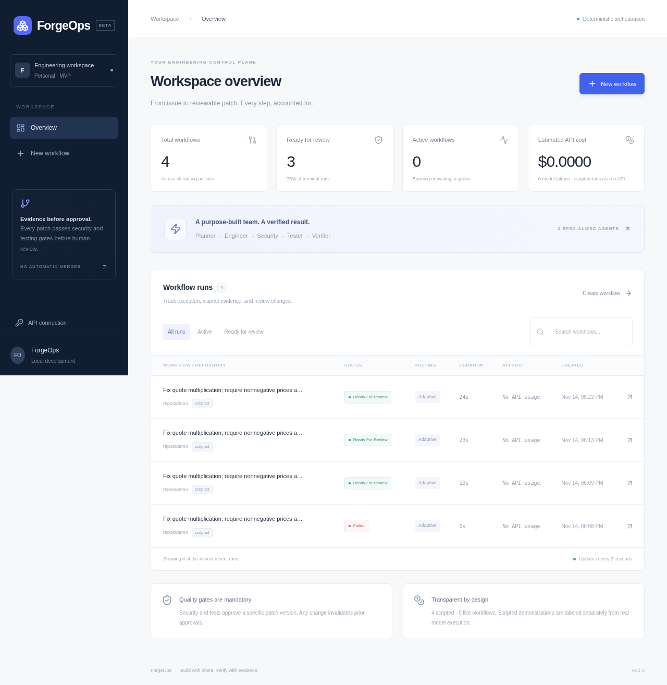
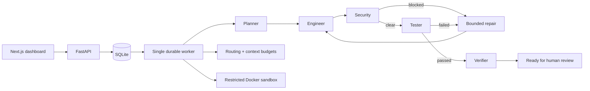

# ForgeOps

**Engineering, orchestrated. Evidence, retained.**

ForgeOps turns a software task and a local Git repository into a reviewable patch using five specialized agents and mandatory security/testing gates. A deterministic state machine owns decisions; model statements never substitute for validation. No workflow merges code.



## What works

- Planner, engineer, read-only security reviewer, independent tester, and final verifier.
- Disposable Git snapshots; restricted Docker execution with no network or host shell fallback.
- Bounded repairs, cancellation, tool/time/cost budgets, patch-bound approvals and safe interruption handling.
- Adaptive small/medium/large routing with configurable IDs and prices; retry-aware escalation and a security tier floor.
- Stage-specific prioritized context, explicit truncation, protected requirements/error evidence, and usage telemetry.
- SQLite histories, versioned diffs, generated tests, scanner logs and final review reports.
- A Next.js dashboard backed by the API: create runs, follow execution, review evidence, download patches.
- Five separately validated benchmark fixtures and a reproducible demo with two real validation failures and repairs.

## Architecture



See [ARCHITECTURE.md](ARCHITECTURE.md), [execution boundaries](docs/SECURITY.md), and [operations/recovery](docs/OPERATIONS.md).

## Quick start

Requires Python 3.12+, Node.js 22+, Git and a running Docker daemon. No model credentials are needed for the **scripted fixture demo**. Commands below start the app on a development machine or a persistent cloud workspace; no paid infrastructure is provisioned.

```sh
python -m venv .venv
.venv/bin/pip install -c backend/requirements.lock -e './backend[test]'
python demo/prepare.py
docker build -f backend/sandbox.Dockerfile -t forgeops-sandbox:local backend
cd backend
../.venv/bin/alembic upgrade head
../.venv/bin/uvicorn app.main:app --host 127.0.0.1 --port 8010 --workers 1
```

In a second terminal:

```sh
cd frontend
npm ci
npm run build
npm run start
```

Open **http://localhost:3000**. API docs: **http://localhost:8010/docs**. Select **New workflow**, keep the prepared `demo` repository and scripted mode, and start. The returned run ID opens its live timeline. Inspect Patch, Tests, Security and Report tabs. Existing checkouts are never modified.

For containers:

```sh
docker build -f backend/sandbox.Dockerfile -t forgeops-sandbox:local backend
mkdir -p runtime demo/repos
docker compose up --build
```

Compose requires a local Linux Docker daemon and the standard socket path. The trusted backend has Docker socket access to create restricted sibling containers. Runtime is mounted at the **same absolute path** on host and backend so sandbox bind mounts resolve correctly. This is a single-operator development configuration; it is not a public hosted service. On Docker Desktop use the Python/Node quick start if sibling bind mounts are unsupported.

For a TLS-intercepting cloud proxy, keep TLS verification on and mount its CA as a **BuildKit secret** for dependency installation. Do not add a proxy certificate to committed images. See the cloud delivery report for the verified environment-specific build procedure.

## Reproducible demo

With the backend running:

```sh
.venv/bin/python demo/run.py
```

The demo submits an actual HTTP request, waits for the database worker, and asserts:

1. Planner generates structured requirements and strategy.
2. Engineer produces a patch with an intentionally scripted unsafe `eval`.
3. Bandit blocks it; the first repair removes it.
4. Pytest then finds that zero quantity incorrectly succeeds; the second repair rejects it.
5. Security and existing/generated tests rerun for the new patch hash.
6. Verifier emits a report, and the workflow reaches `READY_FOR_REVIEW`.

Evidence is saved to `demo/evidence.json`. Scripted agent responses use **known patches**. Docker scanners, tests, repair orchestration, persistence and UI are real. This demonstrates the system's mechanics; it is not evidence of autonomous model task-solving ability.

## Real model mode

Copy `.env.example` to `backend/.env` for host startup. Set `FORGEOPS_API_KEY`, your provider URL, three current model IDs, and `FORGEOPS_PRICING_JSON` keyed by those IDs. Each pricing entry contains numeric `input_per_million` and `output_per_million` USD rates. No model names or prices are hardcoded. Set `FORGEOPS_REPOSITORY_ROOT` to a directory containing the repositories you explicitly want ForgeOps to access. Create a run in **Live model execution** mode with its actual requirements.

The OpenAI-compatible chat-completions adapter supports structured function tools and validated JSON outputs. The provider must support these features. Its transport/tool loop is tested with `httpx.MockTransport`. A real-provider execution was **not performed** in this delivery because model credentials are unavailable. Validate against your provider before relying on it.

Set `FORGEOPS_API_TOKEN` before exposing the backend beyond loopback. Use **API connection** in the dashboard to store the token in the current browser session. Do not put credentials into repository files or task descriptions.

## Routing and context

Adaptive routing considers role, task complexity, affected files, repository size, context size, security criticality, previous actionable failures, and remaining budget. Routine testing can use small; engineering starts at medium; larger changes and useful repair attempts can select large. Tool/infrastructure errors do not automatically escalate. The configured security floor applies to all policies, including `small_only`; this exception is recorded in routing reasons.

`small_only`, `large_only`, and `adaptive` are available both in the UI and benchmark runner. Every role invocation records its tier, model and explanation.

Context starts with immutable requirements, structured plans and recent actionable findings. Stage-specific file/patch selections follow, with lower-priority text truncated or omitted. Oversized essential evidence fails closed. Configure stage limits through `FORGEOPS_CONTEXT_BUDGETS_JSON` and the overall ceiling through `FORGEOPS_CONTEXT_BUDGET`. Token estimates use UTF-8 byte heuristics; actual provider usage is recorded separately. Live requests reserve cost using a more conservative byte upper bound and output cap. Provider billing after transport errors can be unknown.

## Evaluation and checks

```sh
FORGEOPS_DOCKER_TESTS=1 .venv/bin/pytest backend/tests -q
.venv/bin/python benchmarks/run.py --repeats 1
cd frontend
npm run typecheck
npm run build
CHROMIUM_PATH=/usr/bin/chromium npm run test:e2e
```

To include the optional Semgrep integration check, first build `docker build -f backend/semgrep.Dockerfile -t forgeops-sandbox:semgrep backend` and run backend tests with both `FORGEOPS_DOCKER_TESTS=1 FORGEOPS_SEMGREP_TESTS=1`. The scanner integration test verifies that suppression comments do not conceal unsafe code and that a repaired patch clears both scanners.

Omit `CHROMIUM_PATH` when using Playwright's installed browser (`npx playwright install chromium`). The browser suite expects the backend at port 8010, launches the production frontend, creates a run through the UI, waits for both repairs, inspects artifacts and downloads the patch. It also checks mobile layout.

Benchmark fixtures cover function arithmetic, API validation, ownership authorization, an empty-list regression, and a feature spanning two files. Each starts from a committed flawed fixture. Evaluator-owned tests are stored separately from the agent-visible source and run independently after workflow completion. Use `--mode live` only with configured credentials. `--repeats N` repeats every task for every selected policy.

[Measured report](benchmarks/report.json) and [methodology/results](benchmarks/REPORT.md) distinguish scripted execution from real model evidence. Scripted runs have no API calls/tokens/cost; these are absent, not invented. Equal scripted success across routing policies does not demonstrate routing quality or cost savings.

## Limitations and roadmap

This MVP supports Python projects whose dependencies are present in the reviewed sandbox image. It does not clone arbitrary remote URLs, install arbitrary dependencies in runs, authenticate multiple users, learn routing policies, or provide hardened multitenant isolation. The worker is serial. Queued jobs persist; interrupted active jobs fail safely and require a new submission. It does not claim exactly-once recovery.

Bandit scans modified Python; optional Semgrep adds local rules. Neither is a complete security audit. Generated tests can miss requirements and hostile repositories can game their own suites. Review the evidence and patch yourself. LLM security findings are clearly marked unverified. See [security](docs/SECURITY.md) for the full trust model.

Future work: provider-specific compatibility tests, hardened microVM execution, richer repository/dependency adapters, organization authorization, stronger independent acceptance evaluators, resumable stage checkpoints, and routing-policy learning from measured live outcomes.
